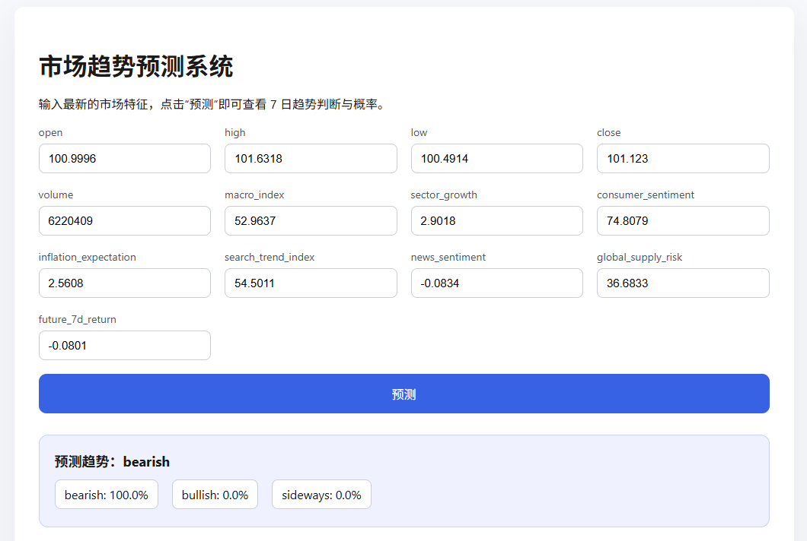
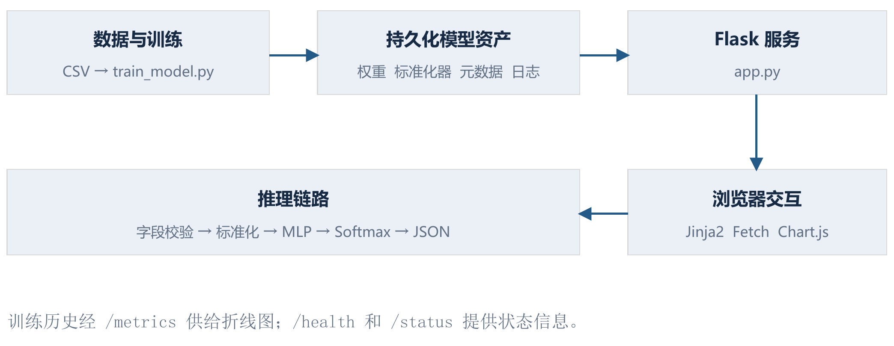
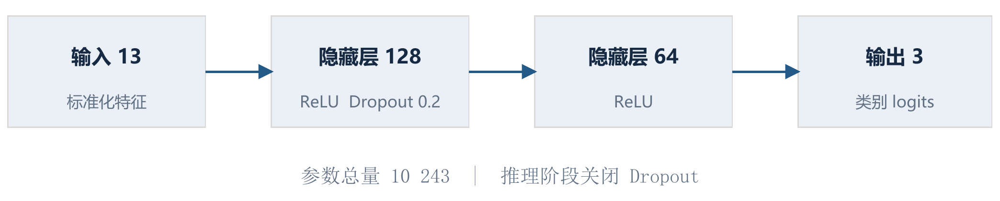
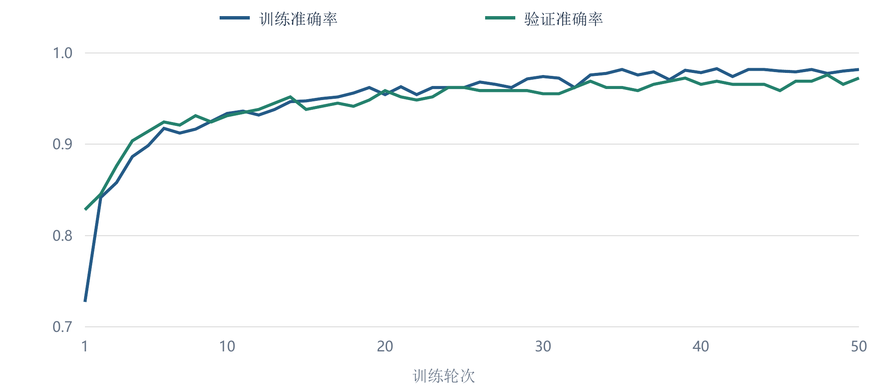
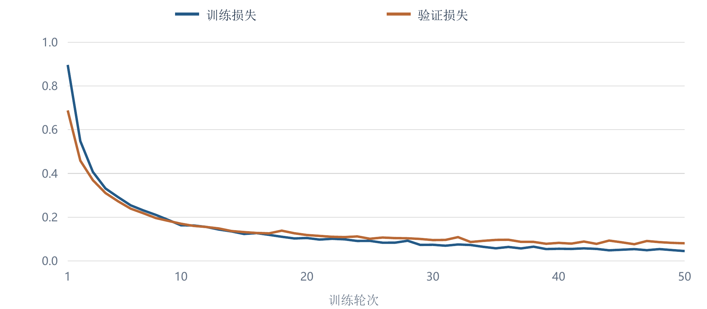

# 基于机器学习的市场预测系统

第13队：刘瀚远、韩启源、曾玺玮、杜凌琳。

本项目将市场特征处理、多层感知机训练、模型服务与网页交互连接为完整应用。系统使用 PyTorch 构建分类模型，通过 Flask 提供单条及批量预测接口，结合 Jinja2 和 Chart.js 展示趋势类别、类别概率与训练过程。

## 功能与界面

- **趋势分类**：输入市场特征，输出下跌（bearish）、盘整（sideways）和上涨（bullish）三类结果及对应概率。
- **批量推理**：接收 JSON 对象数组，按输入顺序返回预测结果。
- **训练可视化**：查询并展示50轮训练与验证准确率、损失记录。
- **交互与状态查询**：提供默认样例、数值输入、提交状态反馈，以及特征、类别和服务信息查询。



页面集中呈现特征输入、趋势结果和三类概率，支持修改样例后提交预测。

## 快速运行

在项目根目录使用 Windows PowerShell 执行：

```powershell
python -m venv .venv
.\.venv\Scripts\python.exe -m pip install -r requirements.txt
.\.venv\Scripts\python.exe -m flask --app app run --host 127.0.0.1 --port 5001
```

浏览器访问 [http://127.0.0.1:5001](http://127.0.0.1:5001)，使用表单中的样例查看分类结果。服务启动时加载 `models/` 内的预训练模型、标准化器和元数据；网页通过网络加载 Chart.js 资源并绘制训练曲线。

项目依赖列于 [requirements.txt](requirements.txt)，复核使用的主要版本列于 [requirements-reproduced.txt](requirements-reproduced.txt)，实测环境记录见 [environment.json](verification/environment.json)。

## 系统架构与模型

系统按数据与模型层、应用服务层和展示层组织。训练脚本生成模型资产，服务端统一执行字段校验、特征排序、标准化、模型推理和结果封装，浏览器通过异步请求更新页面。



模型采用 `13 → 128 → 64 → 3` 的全连接结构，共10 243个可训练参数。隐藏层使用 ReLU，第一隐藏层后配置丢弃率为0.2的 Dropout。训练采用交叉熵损失和 Adam 优化器，学习率为0.001，权重衰减为0.0001，训练批大小为64，训练50轮。



StandardScaler 在训练子集上拟合并保存，服务端使用同一对象变换输入。特征顺序、标签映射和默认样例由 `model_metadata.json` 统一配置，连接训练、接口和页面三个环节。

## 数据与实验结果

项目使用1 453条课程演示样本，日期覆盖2022年1月1日至2025年12月23日。下跌、盘整和上涨类别分别为531、87和835条。随机分层实验采用8∶2划分，训练集为1 162条，验证集为291条。

13维分类设定包含 `future_7d_return` 字段；12维对照使用剔除该字段后的特征集合。补充训练固定 NumPy 与 PyTorch 随机种子为2024，沿用相同隐藏层规模、优化器和训练轮数，比较输入信息条件下的分类结果。

| 实验设定 | 验证准确率 | 宏平均F1 | 盘整召回率 |
| --- | ---: | ---: | ---: |
| 保存模型，13维 | 97.25% | 0.9150 | 77.78% |
| 固定种子训练，13维 | 97.59% | 0.9240 | 77.78% |
| 固定种子训练，12维 | 81.79% | 0.5570 | 0.00% |

以下曲线对应保存的50轮训练历史，展示训练与验证准确率、损失的变化过程。





逐类指标、混淆矩阵、输入对照与时间顺序实验结果见 [verification_results.json](verification/verification_results.json)。

## 接口调用

| 方法 | 路径 | 功能 |
| --- | --- | --- |
| GET | `/` | 加载交互页面 |
| GET | `/health` | 查询特征列表和类别信息 |
| GET | `/status` | 查询服务描述、端点和端口 |
| GET | `/metrics` | 读取50轮训练历史 |
| POST | `/predict` | 执行单条或批量分类 |

使用模型元数据中的默认样例发送单条预测请求：

```powershell
$metadata = Get-Content .\models\model_metadata.json -Raw | ConvertFrom-Json
$body = $metadata.default_payload | ConvertTo-Json
Invoke-RestMethod -Uri http://127.0.0.1:5001/predict -Method Post -ContentType 'application/json' -Body $body
```

响应包含 `input`、`predicted_trend` 和 `probabilities`。对象输入返回单个预测对象，对象数组输入返回对应的结果数组。服务对内容类型、必需字段、数值转换和对象结构执行基础校验。

## 训练与复核

执行模型训练：

```powershell
.\.venv\Scripts\python.exe train_model.py
```

训练更新 `models/` 中的权重、标准化器、元数据和训练历史。保留已有实验版本时，先复制该目录，再启动训练。

执行模型与接口复核：

```powershell
.\.venv\Scripts\python.exe verification/verify_project.py
```

复核脚本评估保存模型、执行接口场景，并运行13维与12维输入对照及时间顺序验证。补充训练使用 CPU 和2个 PyTorch 线程，每组50轮，以参数副本记录最佳验证状态，结果写入 `verification/verification_results.json`。

## 项目目录

```text
app.py                          Flask应用与预测接口
train_model.py                  数据处理、模型训练与评估
requirements.txt                项目依赖
requirements-reproduced.txt     复核环境的主要依赖版本
templates/                      网页模板
data/                           课程演示数据
models/                         权重、标准化器、元数据和训练历史
reports/                        交互界面、架构、网络结构和训练曲线
verification/                   复核脚本、实验结果与环境记录
```
